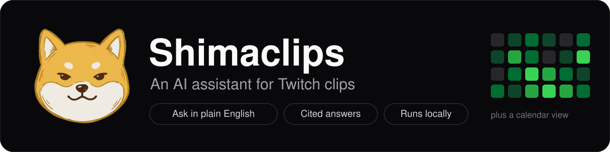
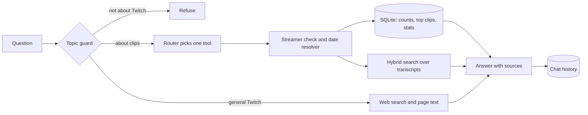

<p align="center">
  
</p>

<p align="center">
  
  
  
  
  
  
  
  
  
  
  
  
  
  
</p>

# Shimaclips

An AI chat assistant for Twitch clips. Ask in plain English and it finds, counts and shows a streamer's clips, tells you who a streamer is, and answers general Twitch questions with cited sources. It runs on local models on your own computer, and also has a calendar view for browsing and downloading clips by month.

Things you can ask:
- "Top 10 clips for each month of 2026 for jasontheween" gives a rewind, with a button to download them all.
- "How many clips did shroud get in 2025?" and "How many views did jasontheween average this month?" are answered from the database, never from the model's memory.
- "Who is stableronaldo?" shows their Twitch profile and their most viewed clips.
- "Find clips where he talks about boxing" searches what was said in the clips. A streamer who has not been transcribed yet is transcribed automatically, with a progress bar.
- "What are 7TV emotes?" is answered from the web, with the sources listed.

## Features
- **Chat with history.** A sidebar keeps past chats on your computer. Reopen one, continue it, delete it.
- **Exact answers for numbers.** Counts, top lists, rewinds and view statistics come from SQL on a local database. Dates such as "last week" or "March 2025" are resolved in code.
- **Search by what was said.** Clips are transcribed locally and searched by meaning and by keyword together. Answers cite the clips and say "I don't know" when nothing matches.
- **Web answers with sources.** General Twitch questions use a web search. The model may only use the pages it was given, and must cite them.
- **Streamer lookup that forgives mistakes.** Misspelt names get suggestions, short names resolve to streamers you already use, and renamed channels are followed.
- **Calendar view and downloads.** A heatmap of clips by day, month and year, hover previews, and batch downloads as a zip.

## How it works



| Piece | What it is | Where it runs |
|---|---|---|
| Backend | FastAPI (Python) | Your computer, port 8000 |
| Front end | Next.js (React, Tailwind) | Your computer, port 3000 |
| Data | SQLite: clips, transcripts, search vectors, chat history, web cache | Your computer |
| LLM | `llama3.1:8b` through Ollama: topic guard, tool routing, cited answers | Your GPU |
| Embeddings | `nomic-embed-text` through Ollama | Your GPU |
| Speech to text | `faster-whisper` (`small.en`) | Your GPU, CPU fallback |
| Twitch data | Twitch Helix API | Internet |
| Web search | DuckDuckGo through the `ddgs` library (optional) | Internet |

There is no paid AI API. The model only chooses a tool and writes cited prose. Plain code resolves dates, checks the streamer against Twitch and runs the queries, so numbers never come from the model. If it is unsure, it abstains: when the rarest word in a topic question appears in none of a streamer's transcripts, it says so instead of guessing.

**Automatic transcription.** A topic question about a streamer with no transcripts starts transcribing them in the background, with a progress bar in the chat. It covers the top clips of the last 12 months, up to 1,000 (about 20 to 25 minutes on an RTX 3060), and re-indexes every 50 clips so topic search works on the part that is done. One job runs at a time.

**Web access.** The question text is sent to DuckDuckGo, and the top three result pages are fetched and read. Page text is treated as untrusted: the model is told never to follow instructions inside it, has no tools, and its output is shown as plain text. Fetches only go to public http or https addresses on ports 80 or 443 (private, local and link-local addresses are refused, including through redirects) with size and time limits. Answers are cached for 24 hours.

## Quick start
1. Create a free app at https://dev.twitch.tv/console (OAuth redirect `http://localhost`, category Other) and copy the client ID and secret.
2. `cp backend/.env.example backend/.env` and fill in both values.
3. Backend: `cd backend && python3 -m venv .venv && .venv/bin/pip install -r requirements.txt`
4. Front end: `cd frontend && npm install`
5. For the AI features, install Ollama (https://ollama.com), then run `ollama pull llama3.1:8b` and `ollama pull nomic-embed-text`, and install `ffmpeg` (`sudo apt install ffmpeg` on Ubuntu or WSL). An NVIDIA GPU makes transcription fast. Without one it falls back to the CPU, which is much slower.
6. `./run.sh`, then open http://localhost:3000. The calendar view is at http://localhost:3000/browse. Ctrl+C stops both servers.

Or run them separately: `cd backend && .venv/bin/uvicorn main:app --reload --timeout-graceful-shutdown 3` and `cd frontend && npm run dev`. The graceful-shutdown flag is needed with `--reload`, otherwise open event streams keep the old process alive.

### Settings
| Variable | Effect |
|---|---|
| `SHIMACLIPS_WEB=0` | Turn off web answers (no text leaves your computer except Twitch API calls) |
| `SHIMACLIPS_TRANSCRIBE=0` | Do not transcribe streamers automatically |
| `SHIMACLIPS_CRAWLER=0` | Do not run the background watchlist crawler |
| `SHIMACLIPS_DB` | Use a different database file (default `backend/shimaclips.db`) |
| `SHIMACLIPS_WORKDIR` | Where downloads and transcription files go (default `backend/.work`, on disk, never RAM-backed `/tmp`) |

## Testing

All of it runs locally and the default run needs no network, GPU or Ollama.

| Layer | Tool | Tests | Result | What it checks |
|---|---|---|---|---|
| Backend unit | pytest | 353 | all pass | Store, fetcher, crawler, tools, date resolver, retrieval maths, web safety, answer pipeline branches |
| Backend integration | pytest, FastAPI TestClient, real SQLite | 26 | all pass | Whole user journeys through the real app with only Twitch, the LLM, embeddings, the web and Whisper faked: asking and history, topic search, automatic transcription with a real background worker, downloads, renames, security |
| Live smoke | pytest `-m smoke` | 9 | all pass | The real services: Ollama and its models, the topic guard, embeddings, routing, Twitch credentials, web search, the download extractor, GPU speech to text, four questions end to end |
| Front-end logic | Vitest | 64 | all pass | Calendar maths, selection, paging, preview timing, sorting |
| Front-end components | Vitest, React Testing Library, jsdom | 35 | all pass | The chat flow, sidebar, progress bar, API client and a regression test for the page-start bug |
| Static checks | `tsc`, ESLint, `next build` | n/a | clean | Types, lint and a production build |

Coverage: backend application code **90%** (93% with the smoke tests), measured with `pytest --cov`. Front end **49%** of statements overall, **86%** in the chat component. The older calendar screens have no component tests yet.

Run them:
```
cd backend && .venv/bin/pytest                       # unit and integration (default)
cd backend && .venv/bin/pytest -m smoke              # live services (needs Ollama, Twitch keys, internet)
cd backend && .venv/bin/pytest --cov                 # with coverage
cd frontend && npm run test                          # Vitest
cd frontend && npx vitest run --coverage             # with coverage
cd frontend && npx tsc --noEmit && npm run lint && npm run build
```

**Defects the tests found, now fixed:**
- A fresh database crashed on the first topic question, because the transcripts table did not exist yet.
- A short name like "jason" was resolved to an unrelated Twitch channel. It now resolves to the known streamer it starts, with a visible note.
- Opening a streamer from the sidebar landed on an empty page in development, because React's remount cancelled the first load. There is now a regression test that fails without the fix.
- The same web question with different punctuation missed the cache.
- Downloads were written to RAM-backed `/tmp` and never cleaned up after a restart. They now use an on-disk work folder, keep only the zip, and are swept at start.

### AI quality
These measure the model-dependent behaviour (not just that the code runs). Details, datasets and limits are in [docs/evaluation.md](docs/evaluation.md).

| Measure | Result |
|---|---|
| Structured answers vs independent SQL | 23 of 23 exact (in-sample) |
| Topic retrieval, hybrid search (top 5) | hit rate 1.00, precision 0.73 |
| Questions written by the project owner, run before any fix | 7 of 12 fully correct, 2 honest "can't", 1 source-dependent, 2 confidently wrong |
| Questions written by the AI, scoring fixed beforehand | 13 of 16 on the first run |
| Web answers on an easy set | 11 of 12 |
| Prompt injection resisted | 3 of 3 |
| Topic guard | 24 of 25 |

The local 8B model is brittle at classifying and routing, and web search is sometimes unavailable. The app says so instead of guessing, and deterministic code backs up the model where a failure was found.

## Calendar view
The calendar lives at `/browse`. Open it with "Manual Streamer Search" in the sidebar, or by clicking a streamer link under an answer. The home page is the chat.

1. Search for a streamer. Matches appear with their profile pictures so you can pick the right channel.
2. A heatmap shows clip density by year, month and week. Cells that are still loading show an approximate count like `1,000+` and are already clickable once some of their clips are loaded.
3. Older years show approximate cells; the current and previous year load exactly.
4. Click a month or a day to see its top clips.
5. Reels show the top clips for this month, this year and most viewed of all time. They are fetched live from Twitch, so they appear within seconds even for very popular streamers. The all-time reel can be filtered by year, and reels can be sorted by most viewed or newest (newest needs an exactly loaded period).
6. Hover a clip card for about 400 ms (or focus it with the keyboard) to play a muted video preview from the Twitch clip embed. Sweeping the pointer across cards starts nothing.
7. Select clips across different periods and download them in one batch.

Exact per-day counts need a full crawl, and Twitch only returns about 1,000 clips per query, so the first load of a very popular streamer can take a long time (the app splits busy periods into days and hours). Everything is cached in `backend/shimaclips.db` (gitignored), so later visits are fast and only recent clips are refetched.


## Watchlist
A short list of streamers is kept preloaded in the background while the app is running. It lives in the local database (not in the repo) and is seeded once with a starting list. The crawler only runs while the backend is running, always yields to a streamer you open yourself, and resumes where it left off. Use the watchlist panel in the app to add, pause or remove streamers, and the "Keep this streamer up to date" toggle in the header to add or remove the open streamer. The same actions are available through the `/api/watchlist` endpoints. Crawling happens only while `./run.sh` (or the backend) is running.

